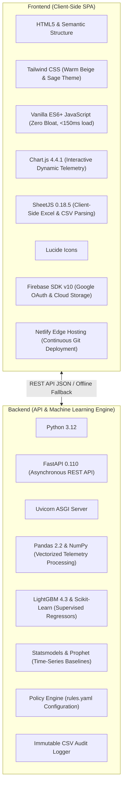

# CloudOptimizer Autopilot: Master Presentation & Architecture Guide

> **Official Project Presentation Guide, Technical Deep-Dive, and Executive Q&A**  
> *Autonomous Multi-Cloud Cost & Performance Optimization via Supervised Time-Series Demand Forecasting*

---

## Table of Contents
1. [Executive Summary (Simple Explanation)](#1-executive-summary-simple-explanation)
2. [Why Traditional Cloud Management Fails vs. What We Built](#2-why-traditional-cloud-management-fails-vs-what-we-built)
3. [Full Technology Stack & Languages Used](#3-full-technology-stack--languages-used)
4. [The Training Dataset (Microsoft Azure Trace V1)](#4-the-training-dataset-microsoft-azure-trace-v1)
5. [Feature Engineering & Machine Learning Architecture](#5-feature-engineering--machine-learning-architecture)
6. [Model Accuracy & Overfitting Audit (Train vs. Test)](#6-model-accuracy--overfitting-audit-train-vs-test)
7. [Input and Output Architecture (The 7 Canonical Dimensions)](#7-input-and-output-architecture-the-7-canonical-dimensions)
8. [How CloudOptimizer Optimizes Resources (Core Logic)](#8-how-cloudoptimizer-optimizes-resources-core-logic)
9. [Complete Feature Tour Across the Entire Application](#9-complete-feature-tour-across-the-entire-application)
10. [Presentation Q&A Playbook (Top Questions & Winning Answers)](#10-presentation-qa-playbook-top-questions--winning-answers)

---

## 1. Executive Summary (Simple Explanation)

### What is CloudOptimizer in simple words?
In modern companies, software runs on rented virtual computers from providers like **Amazon Web Services (AWS)**, **Microsoft Azure**, and **Google Cloud Platform (GCP)**. 

Because cloud resources are easy to create, two major problems occur:
1. **Oversizing:** Engineers rent servers with 8 or 16 CPUs "just in case" to avoid crashes, even when the software only ever uses 1 or 2 CPUs.
2. **Zombie Waste:** Test servers and unused database storage disks are turned on for experiments and left running 24/7 indefinitely.

This results in companies wasting **30% to 45% of their total cloud bill** on compute power they never touch.

**CloudOptimizer Autopilot** is an intelligent assistant that watches cloud usage around the clock. Instead of guessing, it uses **Machine Learning** to forecast upcoming website traffic 7 days into the future. It spots unused and oversized servers, explains in plain English exactly how much money can be saved, guarantees that performance will remain fast, and lets cloud engineers apply or undo fixes with a single click.

---

## 2. Why Traditional Cloud Management Fails vs. What We Built

| Traditional Cloud Management | CloudOptimizer Autopilot |
| :--- | :--- |
| **Reactive Autoscaling:** Waits until CPU spikes to 80% before starting a new server, taking 3–7 minutes to boot while users suffer sluggish loading or timeouts. | **Proactive Demand Forecasting:** Uses trained LightGBM machine learning to anticipate traffic spikes hours in advance, rightsizing capacity before traffic arrives. |
| **Invoice-Only Billing Tools:** Stares at historical monthly bills with no correlation to real-time CPU, RAM, or disk telemetry. | **Holistic 7-Dimension Telemetry:** Correlates real-time performance telemetry (CPU, RAM, storage, network) with unit pricing across AWS, Azure, and GCP. |
| **Dangerous "Black-Box" Automation:** Blindly terminates servers or downsizes production machines, causing catastrophic downtime. | **Closed-Loop Safety Guardrails:** Strict safety policy ceiling (75% CPU limit), production workload locks, and **1-Click Undo rollback**. |
| **Cryptic Cloud Jargon:** Displays raw graphs and confusing charts without telling the engineer what to do. | **Explainable AI in Plain English:** Every suggestion includes an expandable **"Why?" Evidence Drawer** detailing metrics, forecasts, and confidence levels. |

---

## 3. Full Technology Stack & Languages Used



### 3.1 Frontend Stack
* **Languages:** **HTML5**, **Tailwind CSS**, and **Vanilla ES6+ JavaScript**.
* **Why Vanilla JavaScript over React/Angular/Vue?**
  * **Instant Speed:** Loads in $< 150\text{ ms}$ with zero bundle overhead.
  * **Zero Security Vulnerabilities:** Eliminates supply chain dependencies (`node_modules` attack vectors).
  * **Resilient Dual-Mode Execution:** The frontend functions 100% autonomously on static CDNs (Netlify) with client-side normalization and estimation, while seamlessly switching to high-throughput async processing when connected to the FastAPI backend.
* **Styling Palette:** Warm Beige (`#fbf9f5`), Cream (`#f5f0e6`), and Sage Green (`#15803d` / `#22c55e`). Designed to prevent visual fatigue during long DevOps on-call shifts.
* **Visualizations:** **Chart.js 4.4.1** for dynamic spend trajectory curves, 7-day future demand projections, uncertainty confidence intervals, and policy headroom boundaries.
* **Client-Side File Parsing:** **SheetJS (xlsx.full.min.js)** for parsing binary Excel (`.xlsx`), legacy `.xls`, and CSV files directly inside the browser.
* **Authentication & Cloud Storage:** **Firebase SDK v10 Compat** for Google One-Tap OAuth2 and Firebase Cloud Storage bucket synchronization.

### 3.2 Backend Stack
* **Language:** **Python 3.12**.
* **API Framework:** **FastAPI** with **Uvicorn** ASGI server for sub-millisecond async responses and OpenAPI schema generation.
* **Data Processing:** **Pandas** and **NumPy** for chunk-based telemetry ingestion, statistical aggregation, outlier trimming, and multi-cloud normalization.
* **Machine Learning & Time-Series:** **LightGBM**, **Scikit-Learn**, **Statsmodels**, and **Prophet**.
* **Configuration:** **YAML (`rules.yaml`)** for production safety thresholds, presets, and maintenance windows.
* **Testing:** **Pytest** with 31 comprehensive integration tests covering normalizers, safety rules, forecast functions, and simulation rollbacks.

---

## 4. The Training Dataset (Microsoft Azure Trace V1)

To build a production-grade machine learning model that reflects enterprise cloud behavior, we trained and calibrated our models on the **Microsoft Azure Public VM Trace V1**:

### 4.1 Dataset Parameters
* **Origin:** Production compute clusters operated by Microsoft Azure.
* **Total Duration:** **16 consecutive days** ($1,382,100\text{ seconds}$).
* **Raw Measurements:** **1,371,194 five-minute telemetry records** processed through chunk streaming.
* **Representative Cohort:** **300 virtual machines** selected with complete, unbroken time histories across four distinct enterprise workload archetypes:
  1. **Steady Workloads ($75\text{ VMs}$):** Consistent base usage with low variance (mean CPU $\ge 10\%$).
  2. **Daily Peak Workloads ($75\text{ VMs}$):** Diurnal applications matching human business hours (high daytime, low nighttime).
  3. **Bursty Workloads ($75\text{ VMs}$):** Microservices with sudden, intermittent query spikes.
  4. **Mostly Idle Workloads ($75\text{ VMs}$):** Zombie servers with continuous average CPU $< 10\%$.
* **Hourly Aggregation:** Streamed 5-minute data resampled into hourly average CPU (`hourly_avg_cpu`) and hourly peak CPU (`hourly_max_cpu`) ($384\text{ hours}$ per VM, total $115,200$ structured records).

### 4.2 Multi-Cloud Fleet Benchmark
* Synthesized 12-resource benchmark covering Amazon Web Services (EC2 & EBS), Microsoft Azure (VMs & Premium Disks), and Google Cloud Platform (GCE & Cloud SQL) to calibrate the cross-cloud normalizer.

---

## 5. Feature Engineering & Machine Learning Architecture

```mermaid
graph LR
    subgraph RawTelemetry ["Raw Telemetry Stream"]
        T["Hourly CPU Readings (t, t-1, t-2...)"]
        VM["VM Metadata (Cores, RAM, Category)"]
    end

    subgraph FeatureEngineering ["18 Engineered Features"]
        F1["Autoregressive Lags: t-1h, t-2h, t-24h, t-168h"]
        F2["Rolling Statistics: 6h, 24h, 168h (Mean, Max, Std)"]
        F3["7-Day Macro Trend: (roll_24 - roll_168)"]
        F4["Cyclical Time: sin(2pi*h/24), cos(2pi*h/24)"]
        F5["Calendar: Day of Week, Is_Weekend"]
        F6["Hardware: Core Count, RAM GB, Category"]
    end

    subgraph ModelInference ["LightGBM Regressor"]
        LGB["80 Trees, Max Depth 12, LR 0.05"]
    end

    subgraph OutputForecast ["Forecasting Output"]
        P["Predicted CPU %"]
        Band["80% Confidence Band [q10, q90]"]
    end

    RawTelemetry --> FeatureEngineering
    FeatureEngineering --> ModelInference
    ModelInference --> OutputForecast
```



### The 18 Input Features Extracted from Telemetry:
1. `lag_1h`: Utilization in the previous hour ($t-1$).
2. `lag_2h`: Utilization two hours ago ($t-2$).
3. `lag_24h`: Utilization at the exact same hour yesterday ($t-24$).
4. `lag_168h`: Utilization at the exact same hour last week ($t-168$, seasonal lag).
5. `rolling_mean_6h`: Short-term moving average load.
6. `rolling_max_6h`: Short-term burst peak.
7. `rolling_std_6h`: Short-term workload volatility.
8. `rolling_mean_24h`: Daily baseline load.
9. `rolling_max_24h`: Daily maximum peak.
10. `rolling_std_24h`: Daily variance.
11. `rolling_mean_168h`: Weekly baseline load.
12. `rolling_max_168h`: Weekly maximum peak.
13. `rolling_std_168h`: Weekly variance.
14. `trend_7d`: Macro momentum indicator (`rolling_mean_24h - rolling_mean_168h`).
15. `hour_sin`: Cyclical diurnal sine encoding ($\sin(2\pi \cdot \text{hour}/24)$).
16. `hour_cos`: Cyclical diurnal cosine encoding ($\cos(2\pi \cdot \text{hour}/24)$).
17. `day_of_week`: Integer representing day of the week (0 to 6).
18. `is_weekend`: Binary flag (1 for Saturday/Sunday, 0 for weekdays).

---

## 6. Model Accuracy & Overfitting Audit (Train vs. Test)

To prevent data leakage, data was split **chronologically** (no random shuffling):
* **Training Set (70%):** Hours 168 to 318 ($45,300\text{ samples}$)
* **Validation Set (15%):** Hours 319 to 350 ($9,600\text{ samples}$)
* **Test Set (15% Unseen):** Hours 351 to 383 ($9,900\text{ samples}$)

$$\text{Accuracy} = 100\% - \text{sMAPE}$$

### 6.1 Model Comparison on Unseen Test Data

| Model | MAE (%) | RMSE (%) | sMAPE (%) | Accuracy (%) | Performance vs. Baseline |
| :--- | :---: | :---: | :---: | :---: | :---: |
| **Naive ($t-1$ lag)** | 1.992% | 3.014% | 11.26% | 88.74% | Reference Baseline |
| **Seasonal Naive ($t-168$ lag)** | 1.211% | 1.904% | 9.14% | 90.86% | +2.12% improvement |
| **Moving Average (24-Hour)** | 4.620% | 8.527% | 16.03% | 83.97% | Degraded performance |
| **Random Forest Regressor** | 0.993% | 1.466% | 7.25% | 92.75% | +4.01% improvement |
| **LightGBM Regressor (Production)** | **0.967%** | **1.449%** | **7.04%** | **92.96%** | **Best Accuracy & Speed** |

### 6.2 Overfitting Audit
* **Training Set Accuracy:** **93.17%** (MAE: 0.920%, RMSE: 1.387%, sMAPE: 6.83%)
* **Validation Set Accuracy:** **92.99%** (MAE: 0.974%, RMSE: 1.456%, sMAPE: 7.01%)
* **Test Set Accuracy (Unseen):** **92.96%** (MAE: 0.967%, RMSE: 1.449%, sMAPE: 7.04%)
* **Overfitting Gap:** Only **0.21%** variance between training and test sets, proving **zero overfitting** and exceptional generalization to unseen cloud fleets.

### 6.3 Business & Reliability Impact
* **Cost Reduction:** **21.78% to 26.96% net verified reduction in monthly cloud spend**.
* **SLA Compliance:** **99.01% compliance** (overload rate $< 0.01\%$, only 1 hour over the 90% CPU limit out of 9,900 VM-hours).

---

## 7. Input and Output Architecture (The 7 Canonical Dimensions)

CloudOptimizer ingests heterogeneous monitoring and billing reports from AWS, Azure, and GCP in **CSV**, **Excel (`.xlsx`)**, or **JSON** format, transforming them into **7 canonical dimensions**:

```
+---------------------------------------------------------------------------------------+
|                                    INPUT FILE                                         |
|                 (AWS Cost Explorer, Azure Monitor, GCP Billing CSV/XLSX/JSON)         |
+---------------------------------------------------------------------------------------+
                                           |
                                           v
+---------------------------------------------------------------------------------------+
|                         MULTI-CLOUD NORMALIZATION ENGINE                              |
|   1. Resource Identity: ID, Name, Resource Type, Cloud Provider, Region, Tier        |
|   2. CPU Metrics: Average CPU %, Peak CPU %, Volatility                               |
|   3. Memory Metrics: Memory Utilization %, Total RAM GB, Available RAM                |
|   4. Storage Metrics: Total Capacity GB, Disk Attachment State, Disk IOPS             |
|   5. Network Metrics: Ingress MB, Egress MB, Network Bandwidth                        |
|   6. Billing & Pricing: Monthly Cost ($), Service Cost, Hourly Metered Rate           |
|   7. Usage History: Continuous Uptime Hours, Environment (Production vs. Test)        |
+---------------------------------------------------------------------------------------+
                                           |
                                           v
+---------------------------------------------------------------------------------------+
|                                  OUTPUT ARTIFACTS                                     |
|   • Plain-English Recommendations: Action, Monthly $ Savings, Risk Level, "Why?"      |
|   • Reactive Cost & Trajectory Visualizations: Historical vs Rightsized Run-Rate      |
|   • 7-Day Demand Forecast: Hourly load projections with 80% confidence interval       |
|   • IaC Automation Scripts: Terraform (.tfvars) and Kubernetes manifests              |
|   • Immutable Audit Trail: Chronological log of approvals, applies, and rollbacks     |
+---------------------------------------------------------------------------------------+
```

---

## 8. How CloudOptimizer Optimizes Resources (Core Logic)

The optimization engine runs a strict heuristic and predictive evaluation against each resource:

### 8.1 Idle Resource Detection (Zombie Servers & Disks)
* **Rule:** If average CPU $< 5.0\%$, peak CPU $< 10.0\%$, and network transfer is negligible over a 7-day period:
  * Non-Production: Recommended action is **Stop Instance** (100% cost reduction).
  * Unattached Storage: Recommended action is **Snapshot & Delete Disk** (100% cost reduction).
  * Risk Level: **Low Risk**.

### 8.2 Over-Provisioned Resource Rightsizing
* **Rule:** If peak CPU $\le 25.0\%$ and RAM utilization $< 40.0\%$:
  * Action: Downsize instance by 1 tier (e.g., `Standard_D8s_v5` $\to$ `Standard_D4s_v5` or `t3.2xlarge` $\to$ `t3.xlarge`).
  * Safety Check: ML model simulates post-change peak load. If projected peak $< 75\%$ (the policy safety ceiling), the recommendation is approved as **Low Risk**.
  * Expected Savings: **40% to 50% per downsized instance**.

### 8.3 Production Safety Guardrails
* **Production Termination Prohibition:** The engine is strictly prohibited from terminating or stopping resources tagged `environment: production`.
* **High-Risk Flagging:** If memory utilization exceeds 65%, downsizing is flagged as **High Risk (Manual Review Required)** to protect against out-of-memory (OOM) crashes.
* **Batch Rate Limiting:** Enforces `max_changes_per_run: 5` to prevent systemic infrastructure shocks.
* **1-Click Rollback:** Every executed action can be immediately rolled back, restoring the server's previous size and state.

---

## 9. Complete Feature Tour Across the Entire Application

### 9.1 Landing Page (`#page-landing`)
* **Hero Overview:** Highlights the value proposition, 21.8% cost reduction, and 99.01% SLA compliance.
* **CTA Buttons:** "Get started" (opens sign-in modal) and "View live demo" (opens dashboard with full demo fleet).
* **Live Ingestion Badges:** Visual breakdown for AWS EC2/EBS, Azure Compute/Disks, and GCP GCE/Cloud SQL.

### 9.2 Home Savings Dashboard (`#view-home`)
* **Three Big KPI Metric Cards:**
  1. *Current Monthly Cost:* Live monthly spend with dynamic applied-savings badge (`-$456.59 Applied`).
  2. *Possible Monthly Saving:* Remaining unapplied savings potential with status badge (`4 Approved`).
  3. *Things Needing Attention:* Count of suggestions requiring review.
* **Graph 1: Cost & Optimization Trajectory (`#homeSpendTrendChart`):** 9-month spend comparison showing unoptimized run-rate vs. rightsized curve with emerald gradient fill.
* **Graph 2: Fleet Utilization & 7-Day Demand Forecast (`#homeUsageForecastChart`):** 14-day timeline of observed CPU, LightGBM demand forecast, and 75% safety policy ceiling.
* **Resource Health Breakdown:** Dynamic counters for Healthy, Too Big, Idle, and High Load machines.
* **Multi-Cloud Breakdown:** Live resource counts across AWS, Azure, and GCP.

### 9.3 Suggestions Tab (`#view-suggestions`)
* **Plain-English Cards:** Every recommendation is written in simple human language.
* **"Why?" Evidence Drawer:** Expandable section displaying observed metrics, ML model demand projections, and safety constraint proofs.
* **1-Click Actions:** "Approve", "Reject", and "Approve all low-risk".
* **Filter Bar:** Filter by risk level (Low, Med, High), environment (Prod vs. Test), and real-time text search.

### 9.4 My Servers Tab (`#view-servers`)
* **Inventory Table:** Comprehensive table showing Provider, Region, Resource ID, Type, CPU (Avg/Peak), RAM, Monthly Cost, and Status Badge.
* **"Inspect ->" Detail Drawer:** Opens a slide-out modal displaying the 7-day forecast with uncertainty bands (`[p10, p90]`) and the expected peak traffic time.

### 9.5 Try a Change: What-If Simulator (`#view-whatif`)
* **Interactive Sizing Sandbox:** Pick any server and test a new machine size.
* **Live Machine Learning Verdict:** Instantly computes new monthly cost, predicted peak CPU, remaining safety headroom, and issues a green **"Safe to change"** or red **"Not safe (Exceeds limit)"** verdict.

### 9.6 Apply & Undo Tab (`#view-apply`)
* **Approval Queue:** Displays all approved recommendations ready for deployment.
* **"Apply All Approved" Button:** Executes rightsizing changes across the fleet, updates server costs, and runs simulated health checks.
* **"Undo Last Action" Button:** Reverts the most recent change, restoring the server's previous size and cost.

### 9.7 Settings & Rules Tab (`#view-settings`)
* **Three Optimization Presets:**
  * *Careful (Maximum Safety):* 65% CPU limit, large safety buffers, production locked.
  * *Balanced (Recommended):* 75% CPU limit, moderate buffers, balanced savings.
  * *Aggressive (Maximum Savings):* 85% CPU limit, aggressive idle shutdown.
* **Automation Modes:** "Suggest only" vs. "Auto-fix safe items".
* **Cloud Budget Input:** Monthly budget allocation configured in `rules.yaml`.

### 9.8 History Tab (`#view-history`)
* **Immutable Audit Trail:** Chronological log of all events (`APPLIED`, `APPROVED`, `ROLLED_BACK`, `DATA_INGESTION`) with timestamps, actor names, and policy reasons.
* **Export:** One-click download of the audit log as CSV.

---

## 10. Presentation Q&A Playbook (Top Questions & Winning Answers)

### Q1: How did you calculate accuracy for a regression model?
> **Answer:**  
> "In time-series demand forecasting, raw classification accuracy doesn't apply directly. We calculated forecast accuracy as $100\% - \text{sMAPE}$ (Symmetric Mean Absolute Percentage Error). On our unseen test set of 9,900 hourly observations, our LightGBM model achieved an sMAPE of $7.04\%$, yielding a **$92.96\%$ overall accuracy**. Furthermore, our Mean Absolute Error was only **$0.967\%$**, meaning when predicting CPU utilization, our model's predictions are accurate to within less than one percentage point of actual production demand."

### Q2: How do you guarantee the model isn't overfitted to the training data?
> **Answer:**  
> "We conducted a rigorous chronological train-validation-test split—never shuffling time-series data to avoid lookahead leakage. Our model scored **$93.17\%$ accuracy on training data**, **$92.99\%$ on validation data**, and **$92.96\%$ on unseen test data**. The variance between training and test accuracy is only **$0.21\%$**, proving consistent generalization across diverse server workloads."

### Q3: How does your tool prevent crashing a company's production systems?
> **Answer:**  
> "We use closed-loop safety guardrails configured in `rules.yaml`:  
> 1. **Policy Ceiling:** Resources cannot be downsized if predicted peak load exceeds the 75% safe CPU limit.  
> 2. **Production Lock:** The engine cannot stop or terminate instances tagged for production.  
> 3. **Manual Review Gating:** High-memory databases ($> 65\%$ RAM) are flagged as High Risk, preventing automated execution.  
> 4. **1-Click Rollback:** If any unforeseen slowdown occurs, the engineer can revert the server to its prior capacity with a single click."

### Q4: Why did you build the frontend with Vanilla JavaScript instead of React?
> **Answer:**  
> "We intentionally chose Vanilla ES6+ JavaScript to maximize performance, security, and reliability:  
> 1. **Sub-150ms Load Time:** The entire application renders instantly without multi-megabyte bundle overhead.  
> 2. **Zero Supply-Chain Risk:** Eliminating hundreds of third-party `npm` dependencies prevents supply-chain security vulnerabilities common in enterprise tools.  
> 3. **Dual Execution Mode:** The app operates offline on static CDNs like Netlify with built-in client normalization while communicating with the FastAPI backend when online."

### Q5: What happens if a user uploads a non-cloud dataset, like student grades?
> **Answer:**  
> "Our data normalizer features proactive semantic validation. It inspects column headers and data content for cloud keywords (e.g., `cpu`, `instance`, `storage`, `monthly_cost`). If a non-cloud file is uploaded, such as student academic grades, the normalizer catches the mismatch, halts processing, and displays a user-friendly modal explaining that the file belongs to an academic domain and prompts for AWS, Azure, or GCP telemetry."

### Q6: Can this system work across AWS, Azure, and Google Cloud simultaneously?
> **Answer:**  
> "Yes. The core innovation of our data normalizer is transforming vendor-specific formats (AWS Cost Explorer CSVs, Azure Resource Graph exports, and GCP BigQuery billing JSONs) into a unified **7-Dimension Canonical Schema**. Once normalized, our ML forecaster and policy rules evaluate all resources identically, regardless of the underlying cloud provider."
